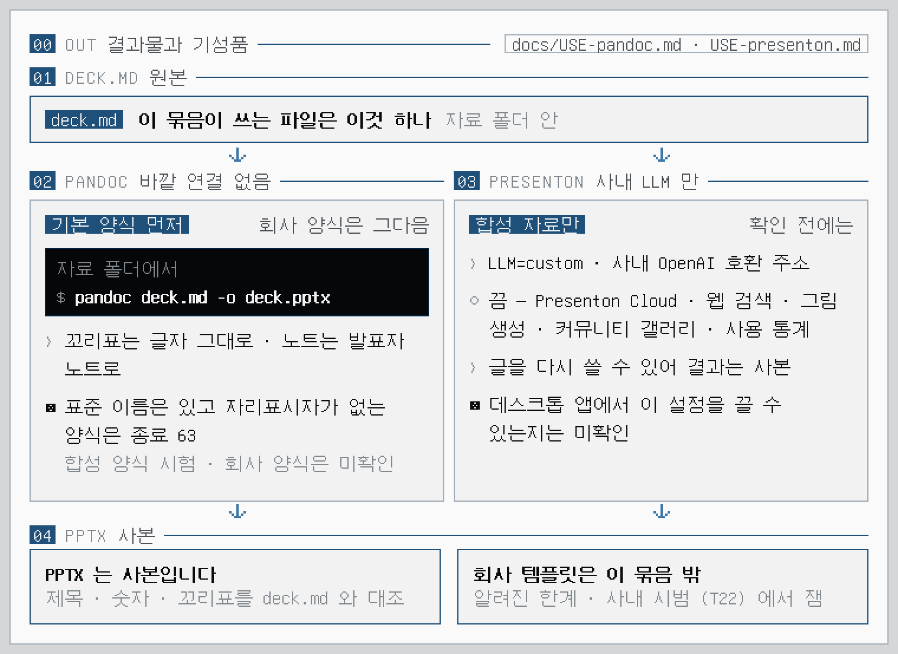

<!-- 소개 페이지 (OP–1 식). 말투 · 이미지 규칙은 works docs/DESIGN.md › 06 문서와 말투. 이미지는 라이트 · 다크 한 쌍. 그림은 docs/images/src/ 의 HTML 에서 tools/readme_pages.mjs 로 다시 그린다 -->
<p align="center">
  <picture>
    <source media="(prefers-color-scheme: dark)" srcset="docs/images/page/hero-dark.png">
    
  </picture>
</p>
<p align="center"><sub>01 OPENCODE · 02 DECK.MD · 03 PPTX · 모범 대화를 그린 그림 — 실제 실행 화면이 아님 · 이름과 숫자는 모두 지어낸 것</sub></p>

<p align="center">
  <picture>
    <source media="(prefers-color-scheme: dark)" srcset="docs/images/page/title-dark.png">
    
  </picture>
</p>

<p align="center">
<b>opencode 플러그인입니다</b> — 창이 따로 없습니다.<br>
opencode 대화창에서 <code>/subordinate</code> 로 시작하고, 결과는 <code>deck.md</code> 한 파일로 나옵니다. PPTX 는 기성품 (pandoc · Presenton) 이 만듭니다.
</p>

<p align="center">
데이터와 그림은 있는데 장표로 옮기는 데 시간이 드는 엔지니어를 위해 만든 도구입니다 — 아직 사내 시범 전입니다. 몇 가지만 꼽으면:<br>
현상 › 분석 › 의견 순서, 장마다 한 문장 주장, 문장마다 종류와 출처 꼬리표, 근거 없는 숫자는 쓰지 않습니다.<br>
의견은 사용자 입에서만, 그림은 받은 그대로, PPTX 는 기성품이.<br>
전부는 아니고, 이 정도입니다:
</p>

<p align="center"><sub>
현상 › 분석 › 의견 · 장마다 한 문장 주장<br>
문장마다 종류와 출처 꼬리표 · 사실 · 해석 · 의견 · 추정 · 미확인<br>
그림마다 근거 줄 · 파일 · 기간 · n · 거르기 · 집계 · 검정<br>
의견은 사용자 입에서만 · 모름은 [미확인] 으로 남김<br>
'한계' 장은 지울 수 없음<br>
질문은 한 번에 하나 · 번호 목록 · 질문 예산 12<br>
그림은 받은 그대로 · 그림에서 읽은 숫자는 후보로만<br>
결과는 DECK.MD 하나 · PPTX 는 PANDOC 또는 PRESENTON<br>
OPENCODE 스킬 + 사내 LLM · 자기 창 없음 · 지금은 이것 하나<br>
실행 의존 없음 · 내 PC 와 사내 LLM 에서만<br>
MIT
</sub></p>

<p align="center"><b>기획 5판</b> · M0 정찰을 마쳤고 PPTX 를 짓는 도구는 만들지 않기로 했습니다 · 스킬 · 에이전트 · 명령이 있고 (T17) 설치 절차도 있습니다 (<a href="INSTALL.md">INSTALL.md</a>) · 사내 시범 전 (T22) · <a href="docs/PLAN.md">기획서 ›</a></p>

<br>

<h3 align="center">근거 없는 숫자는, 쓰지 않습니다.</h3>

<p align="center">
제목은 한 문장 주장, 몸통은 증거 하나, 그림마다 근거 줄이 붙습니다.<br>
글머리 한 줄이 문장 하나이고, 줄 끝 꼬리표가 종류와 출처를 적습니다 — 사실 <code>[f003]</code> · 해석 <code>[해석 · f005 · f006]</code> · 의견 <code>[의견 · a02]</code> · 추정 <code>[추정 · img2]</code>.<br>
자료도 답도 없으면 <code>[미확인]</code> 으로 남기고, 지울 수 없는 ‘한계’ 장에 모읍니다.<br>
꼬리표는 장 위에 그대로 보이고, 해석의 추론은 발표자 노트로 갑니다. 지키는지는 꼬리표를 보고 사람이 확인합니다.
</p>

<p align="center">
  <picture>
    <source media="(prefers-color-scheme: dark)" srcset="docs/images/page/grammar-dark.png">
    
  </picture>
</p>
<p align="center"><sub>02 DECK.MD · 03 PPTX · pandoc 기본 양식의 배치를 그림 · 꼬리표는 장 위에 그대로 · 노트는 발표자 노트로 · 사실 · 해석 · 의견 · 추정 · 미확인</sub></p>

<br>

<h3 align="center">의견은, 말한 사람의 것입니다.</h3>

<p align="center">
인터뷰는 번호 목록으로 한 번에 한 질문, 선택지는 둘에서 넷입니다.<br>
데이터와 그림이 이미 답한 것은 묻지 않고 “이렇게 봤습니다 — 맞습니까” 로 확인만 합니다.<br>
‘모름 · 나중에’ 는 언제나 고를 수 있고, 질문 수에는 예산이 있습니다 (12개).<br>
추천은 자료가 뒷받침할 때만 맨 앞에 달고, 원인 · 확신처럼 사용자의 판단을 묻는 질문에는 달지 않습니다.<br>
의견과 원인은 사용자 입에서만 나옵니다. 시키지 않은 의견은 내지 않습니다.
</p>

<p align="center">
  <picture>
    <source media="(prefers-color-scheme: dark)" srcset="docs/images/page/flow-dark.png">
    
  </picture>
</p>
<p align="center"><sub>01 OPENCODE · SKILL.md › 1 흐름 · 0 자료 받기 › 1 미리 보기 › 2 틀 › 3 현상 › 4 분석 › 5 의견 › 6 줄거리 확인 › 7 쓰기 · 저장</sub></p>

<br>

<h3 align="center">그림은, 받은 그대로.</h3>

<p align="center">
받은 그림은 파일 이름으로 가리킬 뿐, 만들지도 고치지도 다시 저장하지도 않습니다.<br>
그림에서 읽은 숫자는 후보입니다 — “약 103.7 nm 로 읽힙니다. 정확한 값이 있습니까?” 하고 되묻고,<br>
값을 못 받으면 <code>[추정 · img2]</code> 로만 쓰고 ‘한계’ 장에도 남깁니다. 원자료와 어긋나면 원자료가 이깁니다.<br>
화살표 · 강조 상자는 노트에 적고, 사람이 장표 프로그램의 도형으로 얹습니다.
</p>

<br>

<h3 align="center"><code>deck.md</code> 하나, PPTX 는 기성품이.</h3>

<p align="center">
이 저장소는 PPTX 를 만들지 않습니다. 결과물은 <code>deck.md</code> 하나이고, PPTX 는 기성품이 만듭니다.<br>
pandoc 은 자료 폴더에서 <code>pandoc deck.md -o deck.pptx</code> — 이 사용에서는 바깥으로 연결하는 곳이 없고, 기본 양식으로 먼저 만들어 봅니다.<br>
Presenton 은 사내 LLM (<code>LLM=custom</code>) 만 쓰고 Presenton Cloud · 웹 검색 · 그림 생성 · 커뮤니티 갤러리 · 사용 통계를 끈 뒤에 씁니다. 끈 것을 확인하기 전에는 합성 자료만 넣습니다.<br>
기성품의 결과는 사본입니다 — 제목 · 숫자 · 꼬리표를 <code>deck.md</code> 와 대 보고, 어긋난 곳은 <code>deck.md</code> 대로 되돌립니다.<br>
회사 템플릿 위로 옮기는 일은 이 묶음 밖입니다 (알려진 한계).
</p>

<p align="center">
  <picture>
    <source media="(prefers-color-scheme: dark)" srcset="docs/images/page/out-dark.png">
    
  </picture>
</p>
<p align="center"><sub>01 DECK.MD · 02 PANDOC · 03 PRESENTON · 04 PPTX · 결과는 사본 · 회사 템플릿은 이 묶음 밖</sub></p>

<p align="center"><a href="docs/USE-pandoc.md">pandoc 으로 ›</a> &nbsp;·&nbsp; <a href="docs/USE-presenton.md">Presenton 으로 ›</a> &nbsp;·&nbsp; <a href="docs/SPEC-deck-md.md"><code>deck.md</code> 형식 ›</a></p>

<br>

<h3 align="center">내 PC 와 사내 LLM 에서만.</h3>

<p align="center">
인터뷰와 글은 opencode 가 사내 LLM 과 합니다. 이 묶음에 파이썬 도구는 없고, 스킬은 명령도 인터넷도 쓰지 않습니다.<br>
에이전트 권한은 셸 · 웹 · 하위 에이전트를 막고, 자료는 읽기만 합니다. 쓰는 것은 자료 폴더의 <code>deck.md</code> 한 파일뿐이고, 쓰기 전에 사용자에게 묻습니다.<br>
<b>opencode 는 대화를 <code>opencode.db</code> 에 남깁니다.</b> 인터뷰에서 한 말도 거기 남고, 이 묶음은 그것을 지우지 못합니다 (<a href="INSTALL.md#제거">INSTALL.md › 알아 둘 것</a>).<br>
<b>쓸 때 지킬 셋 — 스킬 · 권한이 못 막고 사람만 막습니다.</b> opencode 는 정해 둔 폴더에서 열고 자료 폴더는 명령 인자로 줍니다 (받은 자료 폴더에서 열지 않기) · 허락 창에서 <code>always</code> 를 누르거나 자동 승인으로 열지 않습니다 · 인터뷰 중에 Tab 으로 다른 에이전트로 바꾸지 않습니다 (<a href="docs/REDTEAM.md">REDTEAM.md</a>).<br>
지금은 사내 LLM 전용입니다. Claude 는 나중에, 회사가 들이면 어댑터로 더합니다 (기획서 M5).
</p>

<p align="center">
  <picture>
    <source media="(prefers-color-scheme: dark)" srcset="docs/images/page/who-dark.png">
    
  </picture>
</p>
<p align="center"><sub>00 WHO · SKILL.md 0 · 4 · 5 · 자료 · 사용자 · LLM · 기성품 · 사실 숫자 · 그림 판독 · 질문 · 글 · 의견 · PPTX · 판정</sub></p>

<br>

<h3 align="center">M0 결과.</h3>

<p align="center">
정찰은 끝났습니다. 사내 PC 에서 돌린 여섯 줄의 결과입니다 (2026-11-03 · 숫자와 판정만 받았습니다).<br>
결정 N — 미리 적어 둔 ‘만들지 않을 기준’ 을 기성품이 넘어, PPTX 를 짓는 도구는 접었습니다 (4판의 빌드 · 검사 도구).<br>
남긴 것은 인터뷰 · 보고 문법 · 질문 은행을 묶은 스킬과, 그 결과물 <code>deck.md</code> 입니다.
</p>

<p align="center">
  <picture>
    <source media="(prefers-color-scheme: dark)" srcset="docs/images/page/ticket-dark.png">
    
  </picture>
</p>
<p align="center"><sub>00 M0 RESULT · K1 환경 · K4 템플릿 · K5 OFFICE · K2 사내 LLM · K3 그림 판독 · K6 기준선 · 실제 결과 · 2026-11-03</sub></p>

<p align="center"><a href="docs/PLAN.md">기획서 › 00 5판</a> &nbsp;·&nbsp; <a href="kit/README.md">기록 — M0 정찰 키트 ›</a></p>

<br>

<h3 align="center">알려진 한계.</h3>

<table align="center">
<tr><td width="140">회사 템플릿</td><td width="560">맞추기는 이 묶음이 풀지 않습니다. 사내 템플릿은 자리표시자 대신 도형 · 글상자로 짜인 것으로 보여 (K4) pandoc 이 받는지, 손으로 옮기는 데 얼마나 드는지는 모릅니다 — 사내 시범 (T22) 에서 잽니다 (<a href="docs/PLAN.md">기획서</a> 리스크 23)</td></tr>
<tr><td>대화 기록</td><td>opencode 가 대화를 <code>opencode.db</code> 에 남깁니다 — 인터뷰에서 한 말도 남습니다 (리스크 9 · <a href="INSTALL.md#제거">INSTALL.md</a>)</td></tr>
<tr><td>Presenton</td><td>데스크톱 앱이 바깥으로 연결하는지, 그 설정을 끌 수 있는지는 확인하지 못했습니다 — 확인 전에는 합성 자료만 (<a href="docs/USE-presenton.md">USE-presenton.md</a>)</td></tr>
<tr><td>사람만 막는 것</td><td>위의 '쓸 때 지킬 셋' · 자료 폴더 안의 비밀 파일 · 그림 속 이름 · 주소 (그림은 고치지 않으므로 가려지지 않습니다) — 적대 검토 (<a href="docs/REDTEAM.md">REDTEAM.md</a>) · 리스크 26 – 28</td></tr>
<tr><td>사내 시범 전</td><td>사내 모델이 질문 예산 · 꼬리표를 지키는지는 T22 에서 잽니다. 모범 대화는 사람이 쓴 것이고 실제 실행 기록이 아닙니다</td></tr>
</table>

<br>

<h3 align="center">사양.</h3>

<table align="center">
<tr><td width="140">형태</td><td width="560">opencode 스킬 · 에이전트 · 명령 — 자기 창 없음 · 결과물은 <code>deck.md</code> 한 파일</td></tr>
<tr><td>상태</td><td>기획 5판 · 스킬 · 에이전트 · 명령 있음 (T17) · 설치 절차 있음 (<a href="INSTALL.md">INSTALL.md</a>) · 사내 시범 전 (T22)</td></tr>
<tr><td>실행</td><td>Windows 10 / 11 · opencode · 그림을 읽으려면 사내 모델 설정에 <code>modalities</code> 의 <code>image</code> 가 필요</td></tr>
<tr><td>호스트</td><td>opencode + 사내 LLM (지금은 이것 하나)</td></tr>
<tr><td>의존성</td><td>실행 의존 없음 — opencode + 사내 LLM 이 스킬을 돌리고, PPTX 는 사용자가 pandoc 또는 Presenton 으로 (따로 설치)</td></tr>
<tr><td>저장</td><td><code>deck.md</code> 한 파일 (자료 폴더 안 · 있으면 덮어쓰지 않고 <code>deck-2.md</code> …) · 사용자 원문은 저장하지 않음 (opencode 의 대화 기록은 별개)</td></tr>
<tr><td>네트워크</td><td>스킬은 명령도 인터넷도 쓰지 않음 · LLM 과는 opencode 가 사용자가 설정한 주소로</td></tr>
<tr><td>설치 자리</td><td><code>D:\OPENCODE\subordinate-1</code> · 절차는 <a href="INSTALL.md">INSTALL.md</a></td></tr>
<tr><td>테스트</td><td>unittest · CI Windows + Ubuntu — 저장소 시험은 Python 표준 라이브러리 (M0 키트 시험만 python-pptx — T21 에서 거둠)</td></tr>
</table>

<br>

<h3 align="center">설치는, opencode 에게.</h3>

<p align="center">
파일 세 개 (스킬 · 에이전트 · 명령) 를 opencode 설정 폴더로 복사하는 것이 설치의 전부이고, 파이썬은 필요 없습니다.<br>
opencode 에 <a href="INSTALL.md">INSTALL.md</a> 맨 위의 프롬프트를 붙여넣으면 그 문서대로 합니다. 사내 모델에 그림 입력 (<code>modalities</code>) 을 더하는 단계가 필수입니다.
</p>

<br>

<table align="center">
<tr><td width="620"><a href="INSTALL.md">설치</a> <sub>· opencode 에게 맡기는 단계별 절차 · 업데이트 · 제거</sub></td><td align="right" width="40">›</td></tr>
<tr><td><a href="docs/USE-pandoc.md">pandoc 으로</a> <sub>· deck.md 를 PPTX 로 · 기본 양식 먼저 · 회사 양식은 그다음</sub></td><td align="right">›</td></tr>
<tr><td><a href="docs/USE-presenton.md">Presenton 으로</a> <sub>· 자료가 밖으로 나가지 않게 확인한 뒤에</sub></td><td align="right">›</td></tr>
<tr><td><a href="docs/SPEC-deck-md.md">deck.md 형식</a> <sub>· 꼬리표 · 근거 줄 · 규칙 DM-01 – DM-14 · pandoc 실험 결과</sub></td><td align="right">›</td></tr>
<tr><td><a href="docs/examples/interview_synthetic.md">모범 대화</a> <sub>· 사람이 쓴 합성 인터뷰 한 판 · 실행 기록이 아님</sub></td><td align="right">›</td></tr>
<tr><td><a href="docs/PLAN.md">기획서</a> <sub>· 무엇을 왜 · 보고 문법 · 인터뷰 · M0 결과와 결정 (5판)</sub></td><td align="right">›</td></tr>
<tr><td><a href="kit/README.md">M0 정찰 키트</a> <sub>· 기록 · 사내 PC 에서 돌린 정찰 도구 (시범 뒤에 지움)</sub></td><td align="right">›</td></tr>
<tr><td><a href="RULES.md">규칙</a> <sub>· works 규칙 채택 · W-02 하나만 다름</sub></td><td align="right">›</td></tr>
<tr><td><a href="AGENTS.md">에이전트용 요약</a> <sub>· 이 저장소를 고치는 에이전트가 먼저 읽는 것</sub></td><td align="right">›</td></tr>
<tr><td><a href="LICENSE">라이선스</a> <sub>· MIT</sub></td><td align="right">›</td></tr>
</table>

<br>

<h3 align="center">개발.</h3>

<p align="center">
공개 저장소라서 비밀 · 사설 주소 · 자료 파일이 올라가지 않았는지 검사합니다.<br>
이 문서의 그림은 <code>docs/images/src/</code> 의 HTML 에서 다시 그립니다 (개발용 · 플러그인 실행에는 필요 없음).<br>
M0 키트 시험 일부는 python-pptx 가 없으면 건너뜁니다 (CI 는 설치해서 돌립니다).
</p>

```text
python tools/repo_check.py --strict
python -m unittest discover -s tests -v
node tools/readme_pages.mjs        # README 그림 다시 그리기 · Node + Playwright + Chromium · 글꼴 GNU Unifont (UNIFONT_OTF)
```

<br>

<h3 align="center">works 와의 관계.</h3>

<p align="center">
Subordinate–1 은 <a href="https://github.com/leebobegogigug-blip/Works">works</a> 저장소 밖에 있습니다. 그래도 규칙과 그림 문법은 works 의 것을 씁니다.<br>
<a href="RULES.md">RULES.md</a> 는 works 규칙의 복사본이고 W-02(고정 의존 목록) 하나만 다릅니다.<br>
그림의 팔레트 · 번호 구역 원칙은 works 의 <a href="https://github.com/leebobegogigug-blip/Works/blob/6c9337753f34f1ec747107e9a2bfe2ab47589171/docs/DESIGN.md">DESIGN.md</a> 를 따랐습니다.
</p>

<br>

<p align="center"><sub>
Subordinate–1 · 장표 원고는 시키면 씁니다. 결재 도장은 직접 받으셔야 합니다.<br>
그림의 글꼴: GNU Unifont 15.1.01 · SIL OFL 1.1<br>
화면 문법은 소형 하드웨어 계측기(Teenage Engineering 류)에서 영감을 받았고, 해당 회사와는 관련이 없습니다.
</sub></p>
