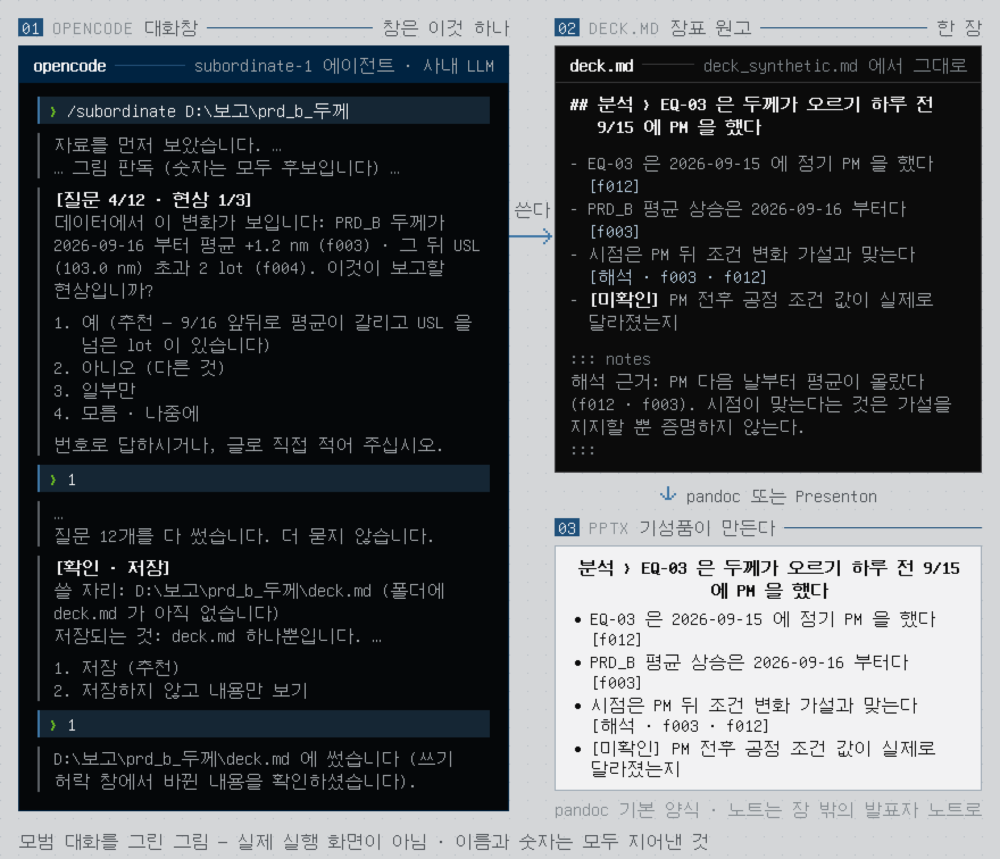
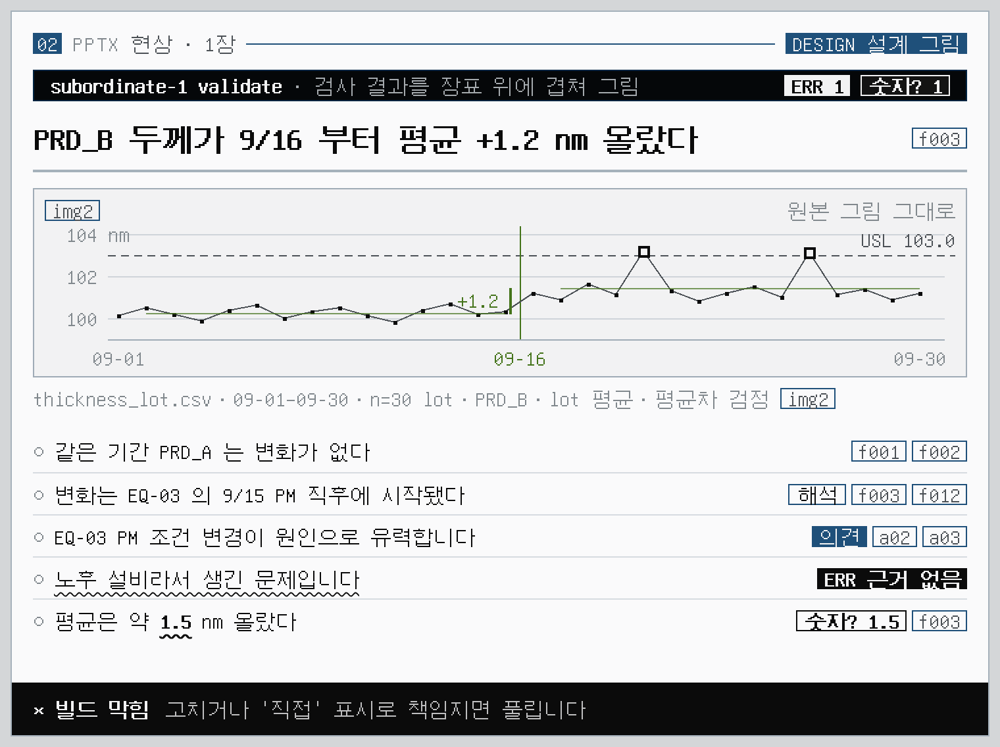
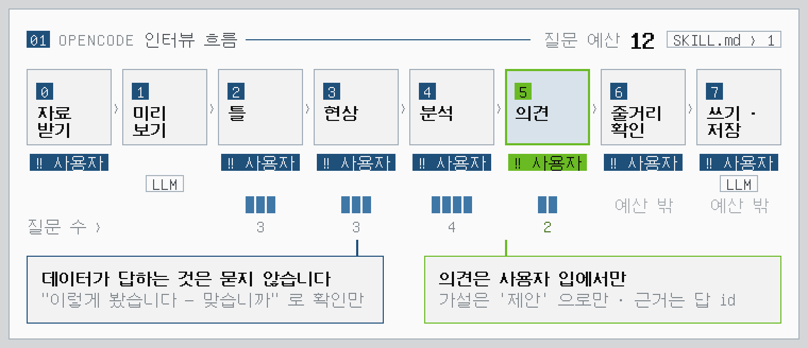
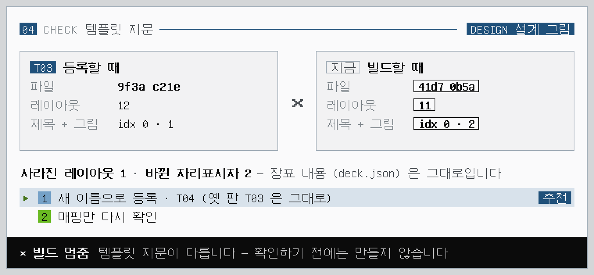
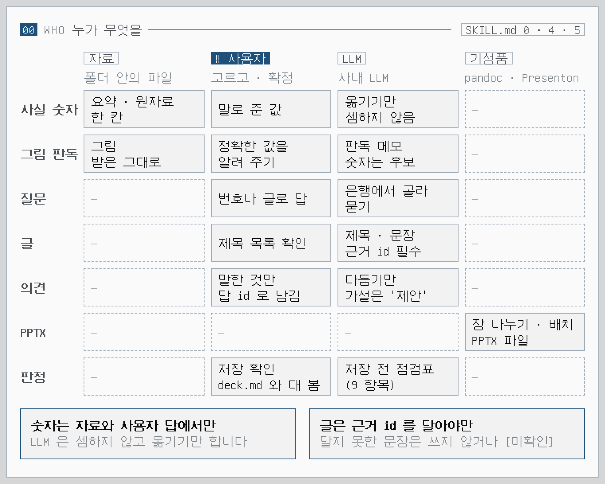
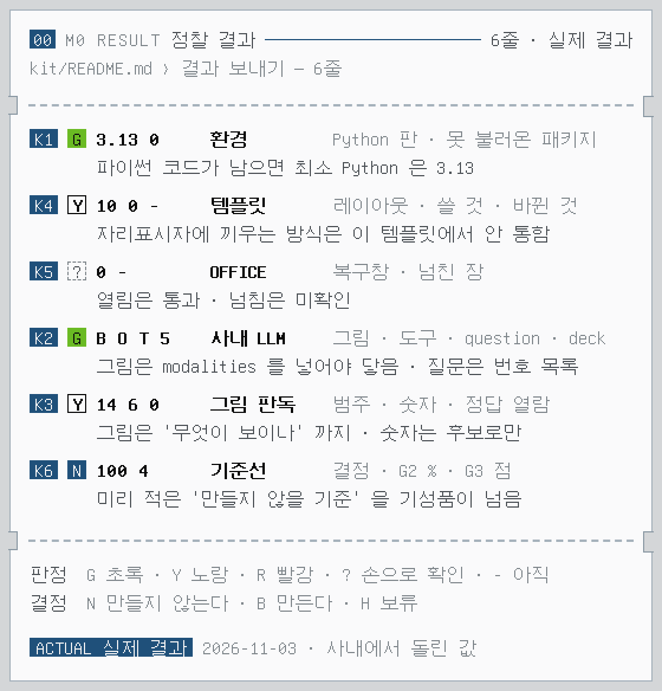

<!-- 소개 페이지 (OP–1 식). 말투 · 이미지 규칙은 works docs/DESIGN.md › 06 문서와 말투. 이미지는 라이트 · 다크 한 쌍. 그림은 docs/images/src/ 의 HTML 에서 tools/readme_pages.mjs 로 다시 그린다 -->
<p align="center">
  <picture>
    <source media="(prefers-color-scheme: dark)" srcset="docs/images/page/hero-dark.png">
    
  </picture>
</p>
<p align="center"><sub>01 OPENCODE · 02 PPTX · 설계 그림 · 만들 모습 · 아직 만들기 전 — 이름과 숫자는 모두 지어낸 것</sub></p>

<p align="center">
  <picture>
    <source media="(prefers-color-scheme: dark)" srcset="docs/images/page/title-dark.png">
    
  </picture>
</p>

<p align="center">
<b>opencode 플러그인입니다</b> — 창이 따로 없습니다.<br>
opencode 대화창에서 <code>/subordinate</code> 로 시작하고, 결과는 PPTX 파일로 나옵니다.
</p>

<p align="center">
데이터와 그림은 있는데 장표로 옮기는 데 시간이 드는 엔지니어를 위해 만들려는 도구입니다. 몇 가지만 꼽으면:<br>
현상 › 분석 › 의견 순서, 장마다 한 문장 주장, 문장마다 근거 칩, 근거 없는 숫자는 올라가지 못합니다.<br>
의견은 사용자 입에서만, 그림은 원본 그대로, 회사 템플릿이 바뀌면 먼저 멈춥니다.<br>
전부는 아니고, 이 정도입니다:
</p>

<p align="center"><sub>
현상 › 분석 › 의견 · 장마다 한 문장 주장<br>
문장마다 종류와 근거 칩 · 사실 · 해석 · 의견 · 미확인<br>
근거 없는 문장은 ERR · 근거에 없는 숫자는 숫자?<br>
그림 아래 근거 줄 · 출처 · 기간 · N · 필터 · 검정<br>
의견은 사용자 입에서만 · 모름은 [미확인] 으로 남김<br>
'확인하지 못한 것' 장은 지울 수 없음<br>
그림은 원본 그대로 · 주석은 PPT 도형으로<br>
질문은 한 번에 하나 · 추천이 맨 앞 · 질문 예산<br>
회사 템플릿 여러 벌 · 바뀌면 멈춤<br>
OPENCODE 플러그인 + 사내 LLM · 자기 창 없음 · 지금은 이것 하나<br>
결정적 파이썬 도구 + PYTHON-PPTX<br>
내 PC 에서만 · 도구는 네트워크를 쓰지 않음<br>
MIT
</sub></p>

<p align="center"><b>기획 5판</b> · M0 정찰을 마쳤고, PPTX 를 짓는 파이썬 도구는 만들지 않기로 했습니다 · 인터뷰로 근거 달린 <code>deck.md</code> 를 쓰고 PPTX 는 기성품 (Presenton · pandoc) 이 만듭니다 · 아래 그림은 4판 설계라 빌드 도구가 그려져 있습니다 — 곧 고칩니다 · <a href="docs/PLAN.md">기획서 ›</a></p>

<br>

<h3 align="center">근거 없는 숫자는, 장표에 못 올라갑니다.</h3>

<p align="center">
제목은 한 문장 주장, 몸통은 증거 하나, 그림 아래에는 근거 줄이 붙습니다.<br>
사실은 데이터가 말하는 것, 해석은 사실을 이은 판단, 의견은 사용자가 한 말.<br>
자료도 답도 없으면 <code>[미확인]</code> 으로 남깁니다. 근거 없는 문장에는 <code>ERR</code>, 근거에 없는 숫자에는 <code>숫자?</code> 가 붙습니다.<br>
하나라도 남으면 빌드가 막히고, 사람이 <code>직접</code> 으로 책임져야 풀립니다.
</p>

<p align="center">
  <picture>
    <source media="(prefers-color-scheme: dark)" srcset="docs/images/page/grammar-dark.png">
    
  </picture>
</p>
<p align="center"><sub>02 PPTX · 설계 그림 · subordinate-1 validate 의 검사 결과를 장표 위에 겹쳐 그림 · 제목 = 한 문장 주장 · 근거 줄 · 사실 · 해석 · 의견 · ERR 근거 없음 · 숫자?</sub></p>

<br>

<h3 align="center">의견은, 말한 사람의 것입니다.</h3>

<p align="center">
인터뷰는 한 번에 한 질문, 선택지는 둘에서 넷, 추천이 맨 앞에 있습니다.<br>
데이터와 그림이 이미 답한 것은 묻지 않고 “이렇게 봤습니다 — 맞습니까” 로 확인만 합니다.<br>
‘모름 · 나중에’ 는 언제나 고를 수 있고, 질문 수에는 예산이 있습니다.<br>
의견과 원인은 사용자 입에서만 나옵니다. 시키지 않은 의견은 내지 않습니다.
</p>

<p align="center">
  <picture>
    <source media="(prefers-color-scheme: dark)" srcset="docs/images/page/flow-dark.png">
    
  </picture>
</p>
<p align="center"><sub>01 OPENCODE · 설계 그림 · 인터뷰 흐름 · 0 자료 › 1 미리 보기 › 2 틀 › 3 현상 › 4 분석 › 5 의견 › 6 줄거리 › 7 빌드 · 검사</sub></p>

<br>

<h3 align="center">그림은, 원본 그대로.</h3>

<p align="center">
받은 그림은 픽셀 그대로 넣고 크기만 맞춥니다. 화살표 · 강조 상자 · 주석은 PPT 도형으로 그 위에 얹습니다.<br>
그림에서 읽은 숫자는 확인 질문이 됩니다 — “약 3.2 로 읽힙니다, 정확한 값이 있습니까?”<br>
원자료와 어긋나면 원자료가 이깁니다. 원자료로 새 그림을 그리는 건 사용자가 고를 때만입니다.
</p>

<br>

<h3 align="center">템플릿이 바뀌면, 먼저 멈춥니다.</h3>

<p align="center">
회사 템플릿은 이름을 붙여 여러 벌 등록하고, 그때의 파일 지문과 레이아웃 지문을 적어 둡니다.<br>
빌드할 때 지문이 다르면 멈추고, 사라진 레이아웃 · 바뀐 자리표시자를 보여 준 뒤 대화창에서 어떻게 할지 묻습니다.<br>
새 판은 새 이름으로 등록하고 옛 판은 지우지 않습니다. 장표 내용(<code>deck.json</code>)은 템플릿을 모릅니다.
</p>

<p align="center">
  <picture>
    <source media="(prefers-color-scheme: dark)" srcset="docs/images/page/template-dark.png">
    
  </picture>
</p>
<p align="center"><sub>01 OPENCODE · 설계 그림 · subordinate-1 build 의 출력 · 등록할 때 · 지금 · 지문 · 빌드 멈춤 · 결과: 확인 필요 · 새 이름으로 등록</sub></p>

<br>

<h3 align="center">내 PC 와 사내 LLM 에서만.</h3>

<p align="center">
인터뷰와 글은 opencode 가 사내 LLM 과 하고, 숫자 · 그림 보관 · 조립 · 검사는 파이썬 도구가 합니다.<br>
모델은 좌표를 쓰지 않습니다. 도구는 네트워크를 쓰지 않고, 사용자 원문은 메모리에만 둡니다.<br>
지금은 사내 LLM 전용입니다. Claude 는 나중에, 회사가 들이면 어댑터로 더합니다 (기획서 M5).
</p>

<p align="center">
  <picture>
    <source media="(prefers-color-scheme: dark)" srcset="docs/images/page/who-dark.png">
    
  </picture>
</p>
<p align="center"><sub>00 WHO · 설계 그림 · LLM · 도구 · 사용자 · 사실 · 그림 · 질문 · 글 · 배치 · 판정</sub></p>

<br>

<h3 align="center">지금은, 정찰 중입니다.</h3>

<p align="center">
아직 만들지 않았습니다. 먼저 사내 PC 에서 되는 것과 안 되는 것을 숫자와 판정으로 알아내고 있습니다.<br>
정찰 키트는 <code>kit/</code> 에 있고, 결과는 여섯 줄만 보내면 됩니다. 파일 이름 · 회사 이름 · 오류 글은 적지 않습니다.<br>
결과가 나오면 기획서를 고치고, 만들지 말지부터 정합니다. 기성품으로 충분하면 만들지 않습니다.
</p>

<p align="center">
  <picture>
    <source media="(prefers-color-scheme: dark)" srcset="docs/images/page/ticket-dark.png">
    
  </picture>
</p>
<p align="center"><sub>00 M0 RESULT · K1 환경 · K4 템플릿 · K5 OFFICE · K2 사내 LLM · K3 그림 판독 · K6 기준선 · 값은 지어낸 예시</sub></p>

<p align="center"><a href="kit/README.md">정찰 키트 ›</a></p>

<br>

<h3 align="center">사양 (설계).</h3>

<table align="center">
<tr><td width="140">형태</td><td width="560">opencode 플러그인 — 에이전트 · 명령 · 스킬 + 파이썬 도구 · 자기 창 없음</td></tr>
<tr><td>상태</td><td>기획 5판 · M0 정찰 끝 · PPTX 빌드 도구는 만들지 않음 (기획서 00) · 플러그인 코드 없음 · 설치 절차는 스킬이 생긴 뒤에</td></tr>
<tr><td>실행</td><td>Windows 10 / 11 · opencode · 최소 Python 판은 정찰 뒤에 정함</td></tr>
<tr><td>호스트</td><td>opencode + 사내 LLM (지금은 이것 하나) · 스킬 + 어댑터(에이전트 · 명령)</td></tr>
<tr><td>의존성</td><td>고정 목록 — <code>requirements.txt</code> 에 적은 것만, 판은 <code>==</code> 로 고정, 라이선스는 허용 목록 안 (python-pptx · pandas · openpyxl · matplotlib · scipy 예정)</td></tr>
<tr><td>저장</td><td><code>%LOCALAPPDATA%\subordinate-1\</code> — 템플릿 · 매핑 · 설정만 · 사용자 원문은 메모리에만</td></tr>
<tr><td>네트워크</td><td>도구는 쓰지 않음 · LLM 과는 opencode 가 사용자가 설정한 주소로</td></tr>
<tr><td>설치 자리</td><td><code>D:\OPENCODE\subordinate-1</code> (정함) · 설치 절차는 아직 없음</td></tr>
<tr><td>알려진 한계</td><td>opencode 가 대화를 자기 데이터베이스에 남깁니다 — 도구 밖의 일이라 매뉴얼에 지우는 법을 적을 예정</td></tr>
<tr><td>테스트</td><td>unittest · CI Windows + Ubuntu — 지금은 저장소 위생 검사와 정찰 키트 시험뿐</td></tr>
</table>

<br>

<table align="center">
<tr><td width="620"><a href="docs/PLAN.md">기획서</a> <sub>· 무엇을 왜 어떻게 만드는지 · 보고 문법 · 인터뷰 · 구조 · 검사 · 로드맵</sub></td><td align="right" width="40">›</td></tr>
<tr><td><a href="kit/README.md">M0 정찰 키트</a> <sub>· 사내 PC 에서 돌리고 결과 여섯 줄만 보내기</sub></td><td align="right">›</td></tr>
<tr><td><a href="RULES.md">규칙</a> <sub>· works 규칙 채택 · W-02 하나만 다름</sub></td><td align="right">›</td></tr>
<tr><td><a href="AGENTS.md">에이전트용 요약</a> <sub>· 이 저장소를 고치는 에이전트가 먼저 읽는 것</sub></td><td align="right">›</td></tr>
<tr><td><a href="LICENSE">라이선스</a> <sub>· MIT</sub></td><td align="right">›</td></tr>
</table>

<br>

<h3 align="center">개발.</h3>

<p align="center">
공개 저장소라서 비밀 · 사설 주소 · 자료 파일이 올라가지 않았는지 검사합니다.<br>
이 문서의 그림은 <code>docs/images/src/</code> 의 HTML 에서 다시 그립니다 (개발용 · 플러그인 실행에는 필요 없음).
</p>

```text
python tools/repo_check.py --strict
python -m unittest discover -s tests -v
node tools/readme_pages.mjs        # README 그림 다시 그리기 · Node + Playwright + Chromium · 글꼴 GNU Unifont (UNIFONT_OTF)
```

<br>

<h3 align="center">works 와의 관계.</h3>

<p align="center">
Subordinate–1 은 <a href="https://github.com/leebobegogigug-blip/Works">works</a> 저장소 밖에 있습니다. 그래도 규칙과 그림 문법은 works 의 것을 씁니다.<br>
<a href="RULES.md">RULES.md</a> 는 works 규칙의 복사본이고 W-02(고정 의존 목록) 하나만 다릅니다.<br>
그림의 팔레트 · 번호 구역 원칙은 works 의 <a href="https://github.com/leebobegogigug-blip/Works/blob/6c9337753f34f1ec747107e9a2bfe2ab47589171/docs/DESIGN.md">DESIGN.md</a> 를 따랐습니다.
</p>

<br>

<p align="center"><sub>
Subordinate–1 · 장표 초안은 시키면 씁니다. 결재 도장은 직접 받으셔야 합니다.<br>
그림의 글꼴: GNU Unifont 15.1.01 · SIL OFL 1.1<br>
화면 문법은 소형 하드웨어 계측기(Teenage Engineering 류)에서 영감을 받았고, 해당 회사와는 관련이 없습니다.
</sub></p>
