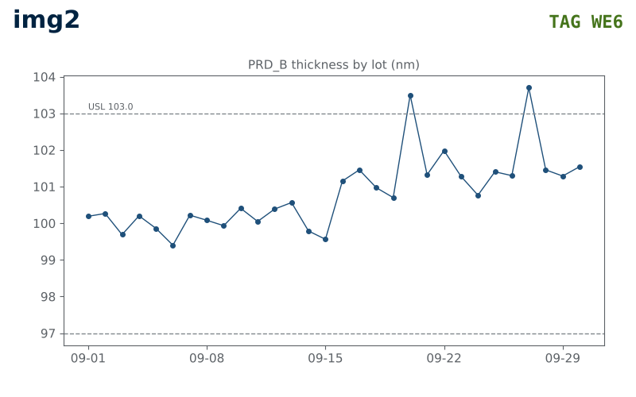
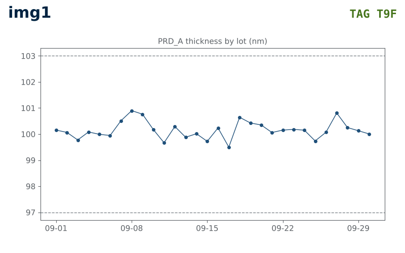
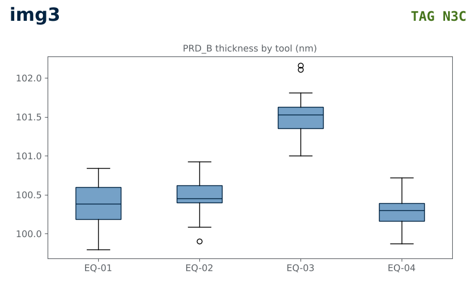

## 요약 › PRD_B 두께가 9/16 부터 1.2 nm 올라 USL 을 넘었다

- 현상: PRD_B 두께 평균이 9/16 부터 +1.2 nm 올랐다 [f003]
- 현상: 그 뒤 USL (103.0 nm) 을 넘은 lot 이 2 개다 [f004]
- 원인: EQ-03 의 9/15 PM 뒤 공정 조건이 바뀐 것으로 본다 — 확신은 유력 [의견 · a02 · a03]
- 요청: EQ-03 PM 조건 재확인 · PRD_B 10 lot 추가 측정 [의견 · a04]

## 현상 › PRD_B 두께 평균이 9/16 부터 +1.2 nm 올랐다

:::::: columns
::: column

:::
::: column
근거: k2_ctx_2.png · 2026-09-01–09-30 · PRD_B 30 lot · 거르기 미확인 · lot 값 · 검정 미확인 [f003 · f011]

- 9/16 이후 평균이 +1.2 nm 높다 [f003]
- 9/16 이후 USL (103.0 nm) 을 넘은 lot 이 2 개다 [f004]
- 가장 높은 lot 은 약 103.7 nm 로 읽힌다 — 원자료 값을 확인해야 한다 [추정 · img2]
:::
::::::

## 현상 범위 › 같은 기간 PRD_A 두께는 변하지 않았다

:::::: columns
::: column

:::
::: column
근거: k2_ctx_1.png · 2026-09-01–09-30 · PRD_A 30 lot · 거르기 미확인 · lot 값 · 변화점 탐지 [f001 · f002 · f011]

- PRD_A 두께 평균은 100.2 nm 이다 [f001]
- PRD_A 에는 변화점 후보가 없다 [f002]
- 변화는 PRD_B 에만 나타났다 [해석 · f002 · f003]
:::
::::::

::: notes
해석 근거: 같은 기간에 PRD_A 는 변화점이 없고 PRD_B 만 평균이 움직였다 (f002 · f003).
:::

## 분석 › EQ-03 의 PRD_B 두께 중앙값이 101.5 nm 로 가장 높다

:::::: columns
::: column

:::
::: column
근거: k2_ctx_3.png · 2026-09-01–09-30 · n=25 + 75 · 거르기 미확인 · 설비별 · 검정 미확인 [f005 · f006 · f011]

- EQ-03 중앙값은 101.5 nm 다 [f005]
- 나머지 세 설비는 0.2 nm 안에 모인다 [f006]
- 두께 상승은 EQ-03 에 몰려 있다 [해석 · f005 · f006]
:::
::::::

::: notes
해석 근거: 다른 세 설비끼리는 0.2 nm 안에서 겹치고 EQ-03 만 따로 높다 (f005 · f006).
검정 결과가 없으므로 유의하다는 말을 쓰지 않는다.
:::

## 분석 › EQ-03 은 두께가 오르기 하루 전 9/15 에 PM 을 했다

- EQ-03 은 2026-09-15 에 정기 PM 을 했다 [f012]
- PRD_B 평균 상승은 2026-09-16 부터다 [f003]
- 시점은 PM 뒤 조건 변화 가설과 맞는다 [해석 · f003 · f012]
- [미확인] PM 전후 공정 조건 값이 실제로 달라졌는지

::: notes
해석 근거: PM 다음 날부터 평균이 올랐다 (f012 · f003). 시점이 맞는다는 것은 가설을 지지할 뿐 증명하지 않는다.
:::

## 의견 › EQ-03 PM 조건 재확인과 10 lot 추가 측정을 요청한다

- 원인은 EQ-03 의 9/15 PM 뒤 공정 조건이 바뀐 것으로 본다 [의견 · a02]
- 확신은 유력이다 — PM 기록을 아직 다 보지 못했다 [의견 · a03]
- EQ-03 PM 조건 재확인 · PRD_B 10 lot 추가 측정을 요청한다 [의견 · a04]

## 한계 › PM 조건 값과 군집 불량의 관계는 아직 확인하지 못했다

- [미확인] PM 전후 공정 조건 값의 차이 — PM 기록을 다 보지 못했다 [a03]
- [미확인] 가장 높은 lot 의 정확한 값 — 그림에서 읽은 후보뿐이다 [img2]
- [미확인] 오른쪽 위 가장자리 불량 군집이 두께 상승과 관계있는지 [f007]
- [미확인] EQ-03 을 피해 흘린 lot 의 두께

## 부록 › 현상과 분석의 사실은 아래 근거 목록에서 왔다

- f001 · PRD_A 두께 평균 100.2 nm (2026-09-01–09-30)
- f002 · PRD_A 두께에 변화점 후보 없음 (같은 기간)
- f003 · PRD_B 두께가 2026-09-16 부터 평균 +1.2 nm
- f004 · PRD_B 2026-09-16 이후 USL (103.0 nm) 초과 2 lot
- f005 · 설비 중 EQ-03 의 PRD_B 두께 중앙값이 가장 높다 (101.5 nm)
- f006 · EQ-01 · EQ-02 · EQ-04 중앙값 차이 0.2 nm 안
- f007 · PRD_B 웨이퍼 맵의 불량 다이가 오른쪽 위 가장자리에 몰려 있다

## 부록 › 나머지 사실과 의견은 아래 목록에서 왔다

- f011 · 자료 기간 2026-09-01–09-30 · PRD_A 30 lot · PRD_B 30 lot
- f012 · EQ-03 은 2026-09-15 에 정기 PM 을 했다 (설비 기록)
- a02 · EQ-03 의 9/15 PM 뒤 공정 조건이 바뀐 것 같다
- a03 · 유력 - PM 기록을 아직 다 보지 못했다
- a04 · EQ-03 PM 조건 재확인 · PRD_B 10 lot 추가 측정
